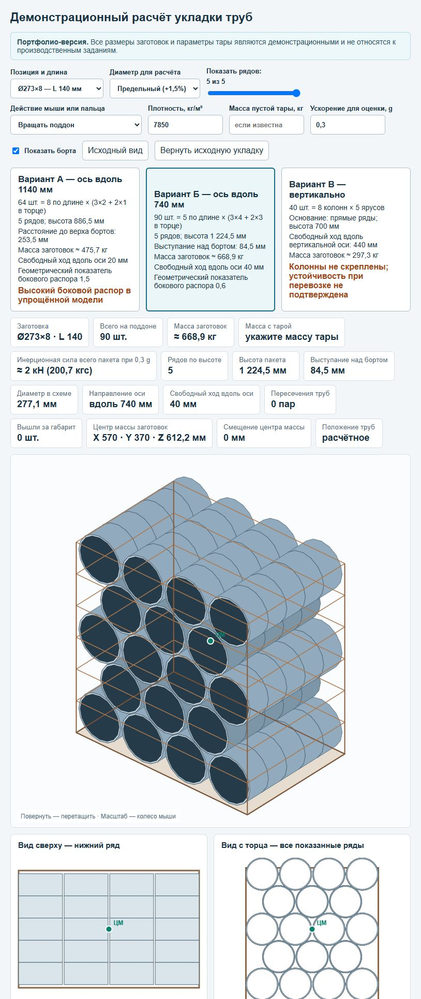
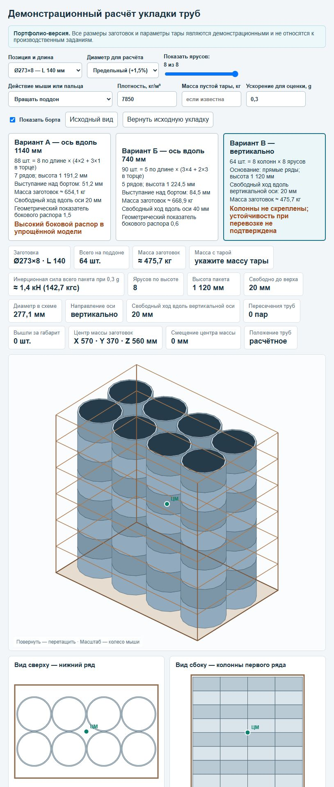

# Интерактивная раскладка труб на поддоне

Портфолио-версия автономного инженерного инструмента для предварительной оценки вариантов укладки трубных заготовок.





## Что умеет

- сравнивает два горизонтальных и один вертикальный вариант укладки;
- рассчитывает количество заготовок, высоту штабеля и выступание над бортом;
- оценивает массу по геометрии трубы и заданной плотности;
- показывает свободный ход и упрощённый показатель бокового распора;
- позволяет перемещать отдельные заготовки и подсвечивает пересечения;
- работает локально в браузере без сервера и внешних библиотек.

## Демонстрационные данные

Размеры заготовок и тары в публичной версии синтетические. Они не являются производственным заданием и не описывают оборудование или продукцию конкретного предприятия.

## Запуск

Откройте [`index.html`](index.html) в актуальном браузере. Интернет не требуется.

## Проверка

```powershell
node tests/validate.js
```

Проверка перебирает все демонстрационные типоразмеры, оба режима диаметра, три ориентации и доступные уровни заполнения; дополнительно сверяет количество отображаемых заготовок и отсутствие геометрических пересечений в исходных схемах.

## Ограничения

Расчёт является геометрической оценкой. Он не заменяет проверку прочности тары, устойчивости груза, способов крепления, грузоподъёмности и требований охраны труда.

## Роль автора

Постановка производственной задачи, формализация ограничений, итерационная проверка результатов и приёмка инструмента. Реализация создавалась с использованием Codex как ассистента разработки.
